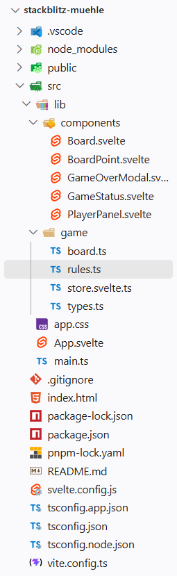

# seiwald-mitschrift

Das ist die README.md-Datei. MD seht für Markdown. Markdown ist eine heutzutage weit verbreitete Auszeichnungssprache (_Markup Languege_, [Wikipedia](https://en.wikipedia.org/wiki/Markup_language)).

Weitere bekannte Auszeichnungssprachen sind:

- Hyperttext Markup Language (HTML)
- Extensible Markup Language (XML)
- Yet Another Markup Language (YAML, YML)

## Installation von Node.JS

Javascript läuft in normelen Umständen in einer Browser-Sandbox (nur in Browser).
Seit ca. 2010 gibt eine Laufzeitumgebung (_Runtime Environment_) für JS, damit damit man auch serverseitig programmieren und ausführen kann: [Node.js](https://nodejs.org/en)

## Installation vin pnpm

Der standardmäßige _Package Manager_ für Node.js ist `npm` (_node packege Manager_). Eine etwas modernere und inzwischen beliebterer Variante ist [`pnpm`](https://pnpm.io/)

## Instalation von Strapi

Installation mit dem Skript `pnpm create strape`.
Daraufhinführt das CLI (_Command Line Interface_) durch die Installation.
Falls bei der Installation sogenannte `build scripts` nicht ausgeführt werden können, schlägt die CLI die Fehelerbehandelung selbständig vor:

1. Wechsle in das Installationsverzeichnis (z.B. mit `cd my-strapi-project`)
2. Neuerlicher Versuch der Installation mit `pnpm install`. Dieser scheitert in der Regel - die Build-Skripte müssen mit `pnpm approve-builds` manuell freigeben werden.

---

# Historische Entwicklung von WebDev

Webdevelopment  hat im Laufe der letzten rund 35 Jahre einige Evolutionsstufen durchlaufen: 

1. Statische Websites (HTML, CSS, gff.JavaScript) - initiale Phase des WEbdevelopment, bei der Inhalt fest im HTML-Code verankert sind. Dominiert in den 1990er Jahren.

2. Dynamische Websites (PHP, JSP, ASP) - Inhalte werden in Datenbanken gespeichert und bei Bedarf dynamisch generiert. Dominant in den 2000er Jahren.

3. *Single-Page Application* (SPA) - mit JavaScript-Frameworks (z.B. React, Vue, Angular, Svelt, ...) erstellte "Webapps", die ähnlich funktionieren wie klassische Desktop-Anwendungen bzw. Handy-Apps. Dominant in den 2010er Jahren. Um Handy-Apps möglichst nah zu kommen, wurde der *Progressive Web App* (PWA)-Standard entwickelt werden. Damit können Webbapps offline funktionieren, 
Push-Benachrichtigungen senden und auf bestimmte native Funktionenn des Geräts zugreifen. Es gibt drei Vorausetzungen, die eine Webbapp erfüllken muss, um als PWA  zu gelten:

    1. Sie muss über HTTPS ausgeliefert werden.

    2.  Sie muss ein Web-App-Manifest besitzen. 
    
    3.  Sie muss Service Worker verwenden, um Inhalte im Cache zu speichern und offline verfügbar zu machen. Ein Service worker ist eine java skirpt datei die im Hintergrund läuft und bestimmte Aufgaben übernimmt, z.B. das Cachen von Inhalten, das Empfangen von Push-Benachrichtigungen oder das Synchronisieren von Daten im Hintergrund, selbst wennd er Browser geschlossen ist. 

Fronted-Framworks wenden folgende Konzepte an, um eine möglichst gute *User Experience* (UX) zu erreichen:

- **Component-based Architecture** (_Komponenten_)**:** Komponenten sind die wiederverwendbare "Lego-" Bausteine einer Webbapp. Sie kapseln HTML, CSS und JavaScript in einer einzigen Einheit. Komponenten können verschachtelt werden, um komplexe Benutzeroberflächen zu erstellen.

- **deklarative Programming:** der Javascript- und Template(HTML)-Code beschreiben, was die Benutzeroberfläche tun soll, anstatt wie sie es tun soll. Das Framework kümmert sich um die Details der Aktualisierung des DOM (Document Object Model), wenn sich der Anwendungszustand ändert. Dabei kommt **Reactivität**  (*Reactivity*) ins Spiel: Wenn sich der Zustand einer Komponente ändert, wird die Benutzeroberfläche automatisch aktualisiert, um diese Änderungen widerzuspiegeln. Wenn die aktualisierung auch in die andere Richtung funktioniert (d.h. wenn sich die Benutzeroberfläche (*User Interface (UI)*) ändert, weil der Benutzer mit ihr interagiert und der Zustand (*state*) der Anwendung entsprechend aktualisiert wird), spricht man von bidirektionaler Reaktivität (_two-way data binding_ ).

  **Logikbausteine** (SChleifen zur Darsteullung von Listen und Bedingungen für das konditionale Ein- und Ausblenden von UI ELementen) werden in den Templents(HTML) der Komponenten definiert. Die Templates werden vom Framework in die entsprechenden DOM-Elemente übersetzt. Komponenten können auch andere Komponente n enthalten (verschachtelt werden), wodurch eine hierachische Struktur entsteht. Die Komponenten können auch **Props** (Eigenschaften) und **Events** (Ereignisse) verwenden, um miteinander zu kommunizieren. Props sind Daten, die von einer übergeordneten Komponente an eine untergeordnete Komponente weitergegeben werden. Events sind BEnachrichtigungen, die von einer untergeordneten Komponente an eine übergeordnete Komponente gesendet werden, um sie über bestimmte Aktionen oder Änderungen zu informieren.

# VibeCoding / AgenticEngineering mit VS-Code und GitHub Copilot
 
VibeCoding passiert in VS-Code in erster Linie über die neue eingeführte Agent View.
Dort können alle Anpassungen des "_Coding Harness_" vorgenommen werde. Wir können unseren _Harness_ mit verschiedene Methoden anpassen:

- **MCP-Server:**
  MCP steht für _Model Context Protokoll_. Es ist ein Standard, der von Anthropic entwickelt wurde. Mit Hilfe von MCP können Chatbots / LLMs (_Large Language model_) auf zusätzliche Tools zugreifen, die sie zu Experten in einem bestimmten Themenbereich machen.

---

# Fronted-Entwicklung

## Ordnerstruktur 

Die Ordnungstruktur einer typischen Frontes-Anwendung sieht so aus:

Der Ordner `.vscode` enthält Einstellungen für den VS-Code-Editor. Der Ordner `node_mdules` enthält die Abhängikeiten (*dependencies*) der Anwendung. DAs sind jene Pakete, die bei der Entwicklung (*buil time* ) und/oder bei der Ausführung (*runtime*) der Anwendung benötigt werden. Alle Abhängigkeiten sind in der Datein `package.json`aufgelistet. Außerdem enthält die Datei `package.json`Informationen über die Anwendung selbst (NAme, Version, , Autor, Lizenz, etc.) und Skripten, die bestimmte Aufgaben automatisieren (z.b. Starten ANwedung, Testen der Anwendung, Erstellen einer Produktionsversion der Anwendung). Der Ordner `public` enthält statische Dateien, die direkt vom Webserver ausgeliefert werden (z.B. Bilder, Schriftarten, Favicon, etc.). Der Ordner `src` enthält den Quellcode der Anwendung. Der Ordner `src/routes` enthält die Routen der Anwendung. Jede Route entspricht einer Seite der Anwendung. Der Ordner `src/lib` enthält wiederverwendbare Komponenten und Hilfsfunktionen. Der Ordner `src/assets` enthält statische Dateien, die von der Anwendung verwendet werden (z.B. Bilder, Schriftarten, etc.). Der Ordner `src/app.html` enthält das HTML-Template der Anwendung. Der Ordner `src/main.js` enthält den Einstiegspunkt der Anwendung. Der Ordner `public`enthält statische Dateien (z.b. Bilder, Fonts, Icons), die direkt vom Browser unter dem jeweiligen Pfad geladen werden können.

Der Ordner `src` enthält den Quellcode der Anwendung. Die Datei `app.css`, `App.svelte` und `main.js` sind die Einstiegspunkte der Anwendung (in diesem Fall eine SPA). Sie werden vom Browser als erstes geladen, wenn die entsprechende Website aufgerufen wird. Die Datei `app.css` enthält die globalen CSS-Stile. Die Datei `App.svelte` ist die Hauptkomponente der Anwendung, die anderen Komponenten enthält und in der Benutzeroberfläche (UI) anzeigt. Die Datei `main.js` ist der Einstiegspunkt für das JavaScript/TypeScript der Anwendung. Sie initialisiert die Anwendung in der `App.svelte` und bindet sie an das HTML_Dokument (`index.html` im Root-Ordner).
